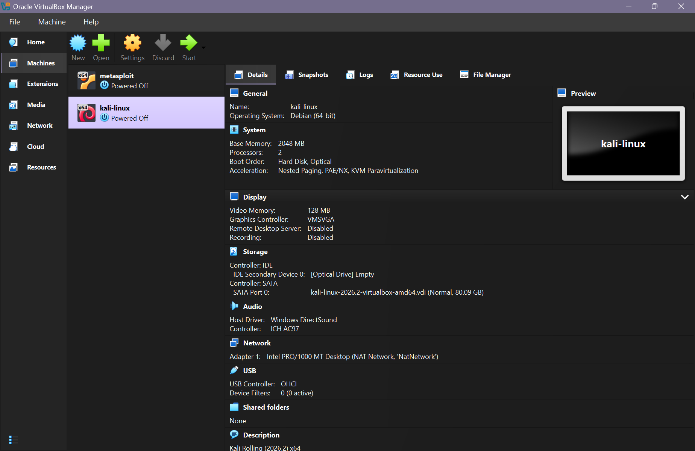
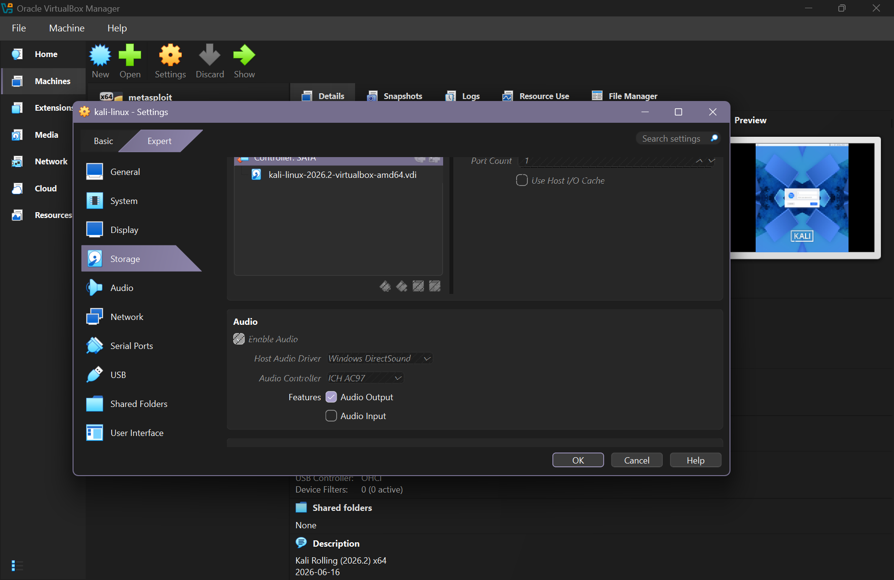
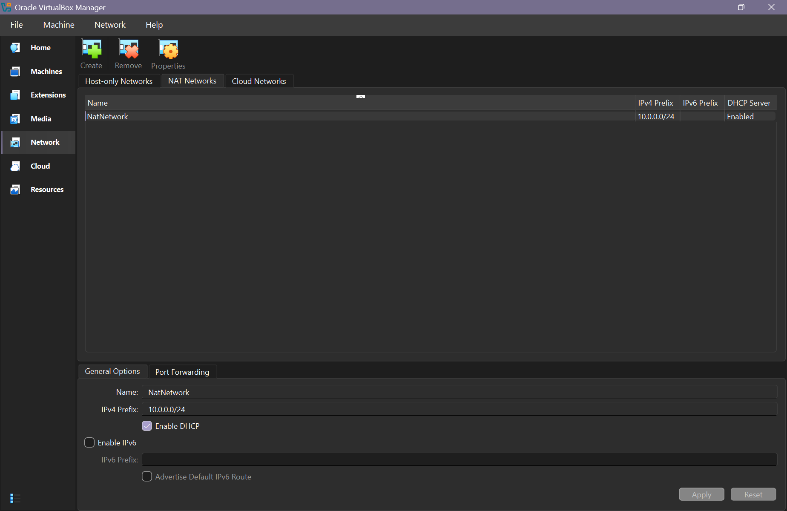
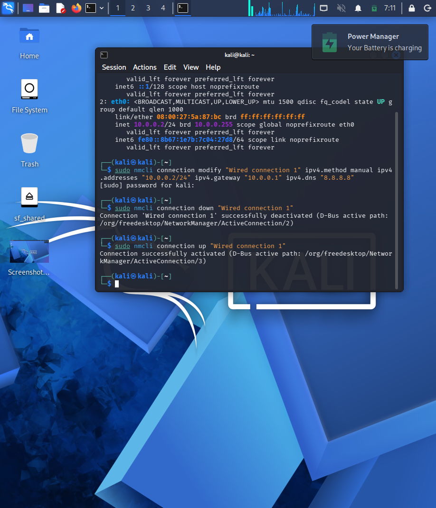
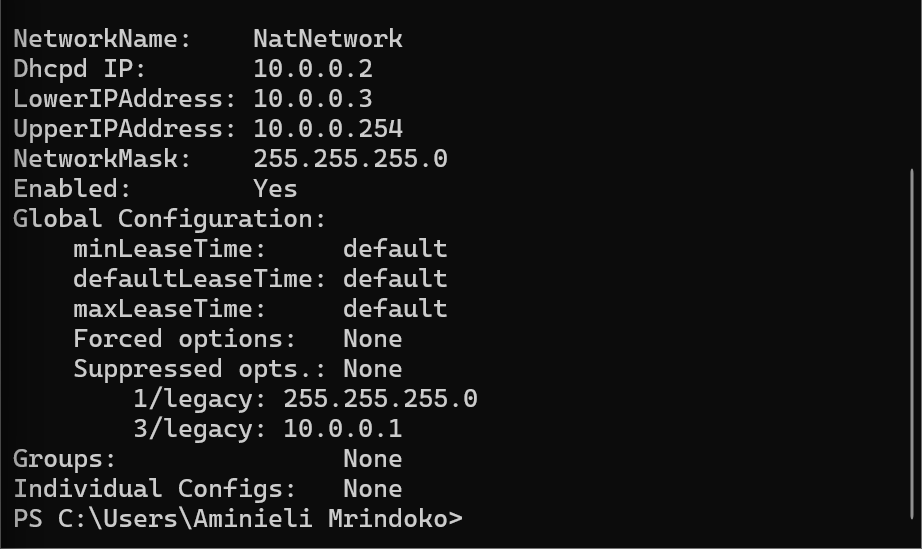
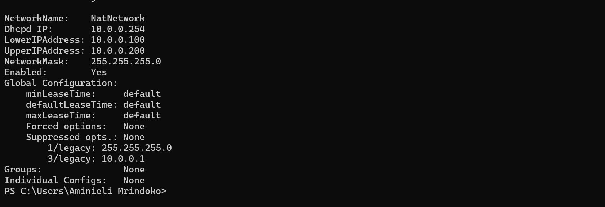
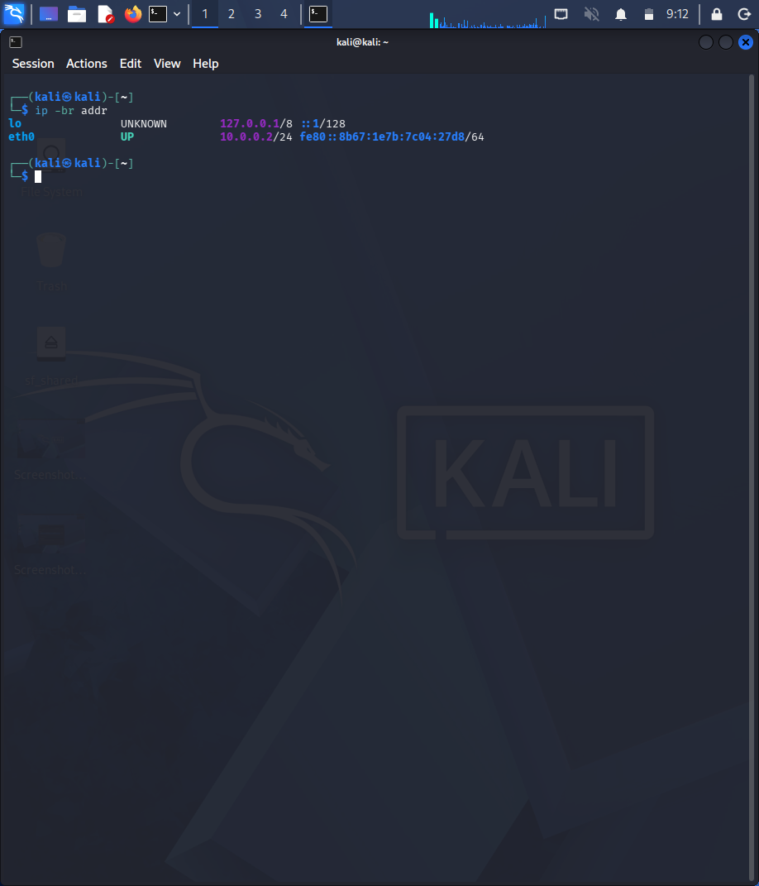
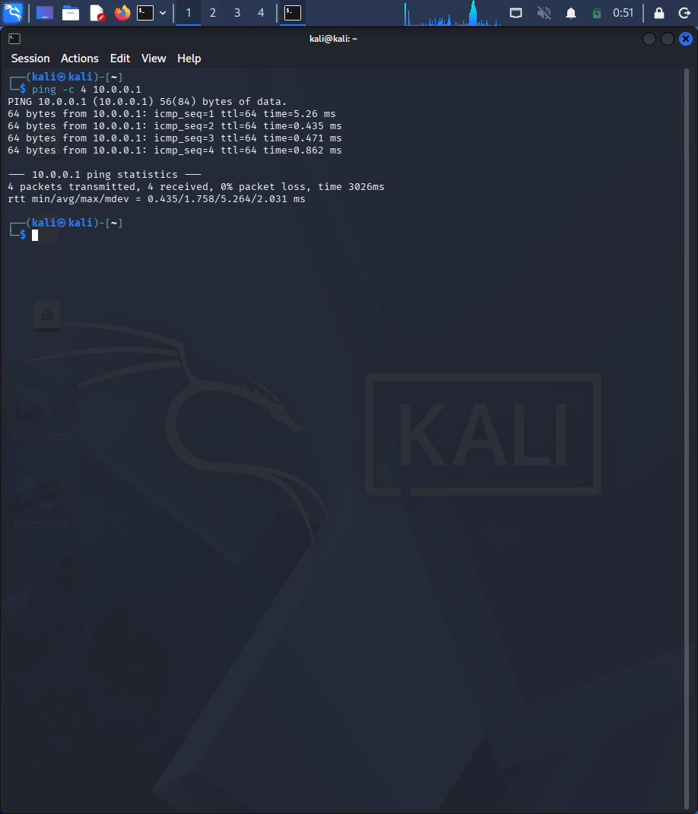
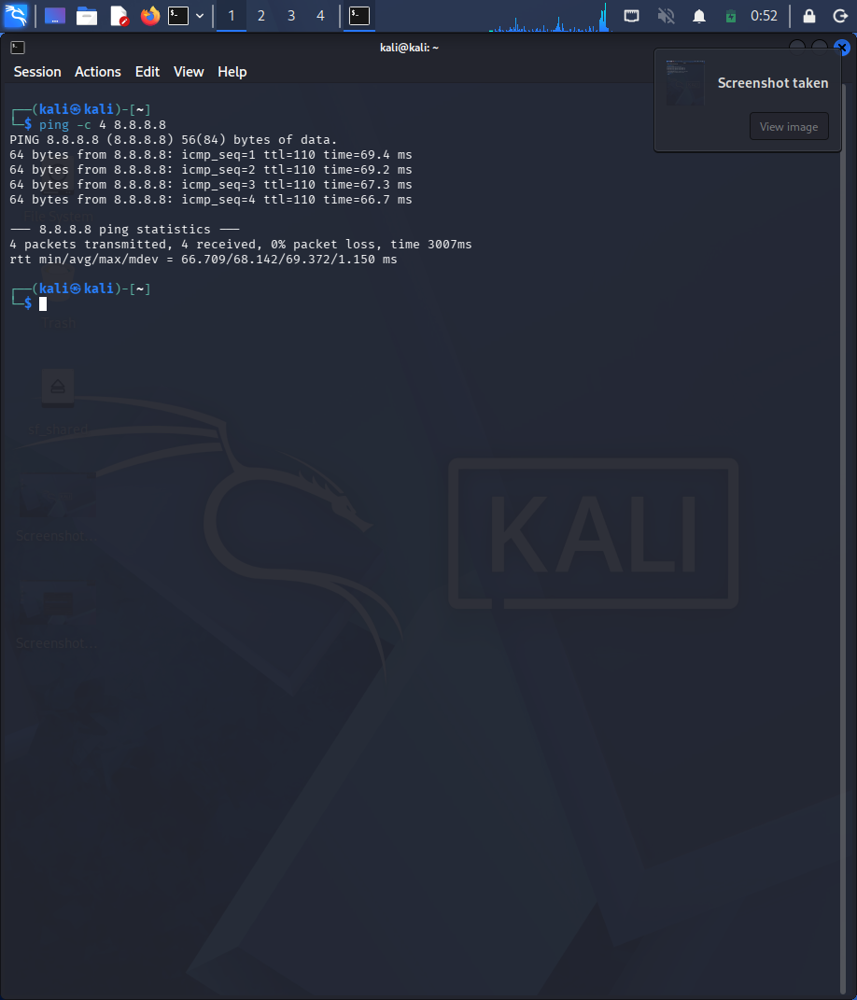

# NETWORKWALKS-B084-WK1-PM1-CYBERSECURITY-LAB-SETUP

<div align="center">

# 🔐 Cybersecurity Lab Environment Setup

### Building a Virtual Laboratory for Penetration Testing and Ethical Hacking

**NetworkWalks Cybersecurity Internship | Week 01**

**Learn. Build. Secure.**

<p>
  
  
  
  
  
  
  
</p>

</div>

---

## 📌 Project Overview

This project documents the setup and configuration of a virtual cybersecurity laboratory using Oracle VirtualBox, Kali Linux, and Metasploitable.

The laboratory provides a controlled environment for learning cybersecurity concepts, understanding virtual networking, performing network reconnaissance, and practicing authorized penetration testing.

During the initial setup, I configured a VirtualBox NAT Network, investigated an IPv4 configuration failure in Kali Linux, examined the VirtualBox DHCP configuration, and modified the DHCP server settings to resolve an address conflict involving `10.0.0.2`.

This repository records the configuration process, troubleshooting steps, commands used, screenshots, and lessons learned.

## 🎯 Project Objectives

* Configure a virtual cybersecurity laboratory using VirtualBox.
* Set up Kali Linux as the primary security-testing environment.
* Prepare Metasploitable for controlled vulnerability-assessment exercises.
* Configure a VirtualBox NAT Network.
* Understand DHCP servers and static IP addressing.
* Investigate NetworkManager errors.
* Verify network connectivity between virtual machines.
* Establish a baseline for future cybersecurity exercises.
* Document the work professionally on GitHub.

---

## 🏗️ Lab Architecture

The laboratory uses a Windows host running VirtualBox, with Kali Linux and Metasploitable as virtual machines.

```text
                  Physical Computer
                     Windows Host
                          |
                    Oracle VirtualBox
                          |
                    NatNetwork
                     10.0.0.0/24
                          |
             +------------+------------+
             |                         |
        Kali Linux               Metasploitable
        Attacker VM               Target VM
        10.0.0.2*                 IP TBD*
             |
      Authorized Security Testing
      - Nmap
      - Wireshark
      - Burp Suite
      - Other approved tools
```

`*` These addresses and connectivity must be verified in the running environment before being treated as confirmed.

### 📷 Lab Architecture Screenshot



> **Screenshot placeholder:** Capture the VirtualBox Manager showing the Kali Linux and Metasploitable virtual machines.
>
> **Filename:** `screenshots/01-virtualbox-vms.png`

### Why use a NAT Network?

A VirtualBox NAT Network allows connected virtual machines to communicate with one another while providing outbound connectivity through network address translation.

Vulnerable target machines must remain on the intended laboratory network and must not be exposed through unnecessary port forwarding or other network interfaces.

---

## ⚙️ Lab Configuration

| Component                     | Configuration                |
| ----------------------------- | ---------------------------- |
| Host operating system         | Windows                      |
| Virtualization platform       | Oracle VirtualBox            |
| Attacker machine              | Kali Linux                   |
| Kali version                  | Kali Linux Rolling 2026.2    |
| Kali RAM                      | 2048 MB                      |
| Kali CPU allocation           | 2 virtual CPUs               |
| Target machine                | Metasploitable               |
| Virtual network               | `NatNetwork`                 |
| IPv4 network                  | `10.0.0.0/24`                |
| Default gateway               | `10.0.0.1`                   |
| Intended Kali IP              | `10.0.0.2/24`                |
| DNS server                    | `8.8.8.8`                    |
| Updated DHCP server address   | `10.0.0.254`                 |
| Updated DHCP allocation range | `10.0.0.100–10.0.0.200`      |
| IPv6                          | Disabled on this NAT Network |

**Verification note:** The updated DHCP configuration was reported by VirtualBox. Kali's static address, gateway reachability, DNS resolution, and target connectivity must be tested before the lab can be considered fully operational.

---

# 🪜 Lab Setup Procedure

## Step 1: Install and Prepare VirtualBox

Oracle VirtualBox was used to create and manage the virtual machines.

The existing environment contains two virtual machines:

* `kali-linux` — the security-testing environment.
* `metasploit` — the intended vulnerable target environment.

Virtualization makes it possible to run multiple operating systems on a single physical computer.

### 📷 Screenshot: VirtualBox Virtual Machines


> **Add your screenshot here:** Show the VirtualBox Manager with both virtual machines listed.
>
> **Filename:** `screenshots/01-virtualbox-vms.png`

---

## Step 2: Prepare the Kali Linux Virtual Machine

Kali Linux Rolling 2026.2 was installed and configured as the primary security-testing environment.

The virtual machine configuration is:

```text
VM Name:       kali-linux
RAM:           2048 MB
Virtual CPUs:  2
Network:       NatNetwork
Adapter:       Intel PRO/1000 MT Desktop
```

A shared folder was also configured between Windows and Kali to facilitate file transfers.

### 📷 Screenshot: Kali Linux Environment


> **Add your screenshot here:** Capture the Kali Linux desktop after the VM starts successfully.
>
> **Filename:** `screenshots/02-kali-desktop.png`

### 📷 Screenshot: Kali VM Settings



> **Add your screenshot here:** Show the Kali VM's system and network settings. Make sure the screenshot clearly shows the allocated memory, processors, and network attachment where possible.
>
> **Filename:** `screenshots/03-kali-vm-settings.png`

---

## Step 3.0.: Create the NAT Network

A VirtualBox NAT Network named `NatNetwork` was used for the laboratory.

The intended network configuration is:

```text
Network Name: NatNetwork
IPv4 Network: 10.0.0.0/24
Gateway:      10.0.0.1
DHCP:         Enabled
IPv6:         Disabled
```

The network configuration was inspected in Windows PowerShell:

```powershell
& "C:\Program Files\Oracle\VirtualBox\VBoxManage.exe" list natnets
```

The command confirmed that `NatNetwork` used the `10.0.0.0/24` network with gateway `10.0.0.1`.

### 📷 Screenshot: NAT Network Configuration



> **Add your screenshot here:** Capture the VirtualBox NAT Network settings showing the network name, IPv4 prefix, and DHCP configuration.
>
> **Filename:** `screenshots/03-natnetwork-settings.png`

---
## Step 3.1 : Configure the Kali Linux Network

The Kali Linux network configuration was checked and configured with a consistent IPv4 address.

configuration:

```text
IP Address: 10.0.0.2
Subnet Mask: 255.255.255.0
Gateway: 10.0.0.1
DNS: 8.8.8.8
```

A consistent IP address makes it easier to document the lab and reference the Kali machine in future exercises.


## Step 4: Investigate the Kali Static IP Failure

The original intention was to assign Kali the static IPv4 address `10.0.0.2`.

The connection was configured using NetworkManager:

```bash
sudo nmcli connection modify "Wired connection 1" \
  ipv4.method manual \
  ipv4.addresses "10.0.0.2/24" \
  ipv4.gateway "10.0.0.1" \
  ipv4.dns "8.8.8.8"
```

The connection was then restarted:

```bash
sudo nmcli connection down "Wired connection 1"
sudo nmcli connection up "Wired connection 1"
```

Activation initially failed with an IP configuration error.

To investigate the problem, NetworkManager logs were inspected:

```bash
sudo journalctl -xe \
  NM_CONNECTION=13145628-be0a-3498-ac18-9c40899fa5cd \
  + NM_DEVICE=eth0 \
  --no-pager -n 50
```

The logs indicated that `10.0.0.2` was already in use.

### 📷 Screenshot: Static IP Configuration Error



> **Add your screenshot here:** Capture the NetworkManager activation error or relevant log output showing the IP address conflict.
>
> **Filename:** `screenshots/04-static-ip-error.png`

**Lesson learned:** Error messages and system logs can help identify the underlying cause of a network configuration failure.

---

## Step 5: Identify the DHCP Address Conflict

The VirtualBox DHCP server configuration was inspected from Windows PowerShell:

```powershell
& "C:\Program Files\Oracle\VirtualBox\VBoxManage.exe" list dhcpservers
```

The original DHCP configuration for `NatNetwork` was:

```text
NetworkName:    NatNetwork
Dhcpd IP:       10.0.0.2
LowerIPAddress: 10.0.0.3
UpperIPAddress: 10.0.0.254
NetworkMask:    255.255.255.0
Enabled:        Yes
```

The investigation identified that VirtualBox was using `10.0.0.2` as the DHCP server address. Therefore, Kali could not safely use that same address while the conflict remained.

### 📷 Screenshot: DHCP Configuration Before the Change



> **Add your screenshot here:** Capture the PowerShell output showing the original DHCP server address and allocation range.
>
> **Filename:** `screenshots/05-dhcp-before.png`

**Lesson learned:** An address that appears available for a virtual machine may already belong to a network infrastructure component.

---

## Step 6: Modify the VirtualBox DHCP Configuration

To make `10.0.0.2` available for Kali on the intended network, the DHCP server was moved to `10.0.0.254` and the dynamic allocation range was narrowed.

The following command was executed in Windows PowerShell:

```powershell
& "C:\Program Files\Oracle\VirtualBox\VBoxManage.exe" dhcpserver modify --network=NatNetwork --server-ip=10.0.0.254 --lower-ip=10.0.0.100 --upper-ip=10.0.0.200 --netmask=255.255.255.0 --enable
```

The updated configuration was checked using:

```powershell
& "C:\Program Files\Oracle\VirtualBox\VBoxManage.exe" list dhcpservers
```

VirtualBox reported the updated settings:

```text
NetworkName:    NatNetwork
Dhcpd IP:       10.0.0.254
LowerIPAddress: 10.0.0.100
UpperIPAddress: 10.0.0.200
NetworkMask:    255.255.255.0
Enabled:        Yes
```

### 📷 Screenshot: DHCP Configuration After the Change



> **Add your screenshot here:** Capture the PowerShell output showing the updated DHCP server address and allocation range.
>
> **Filename:** `screenshots/06-dhcp-after.png`

**Important observation:** A separate VirtualBox network named `natnetwork` with a lowercase `n` was also listed, and its DHCP configuration remained unchanged. The Kali VM must be confirmed as attached to the intended `NatNetwork`.

The DHCP change does not, by itself, prove that `10.0.0.2` is unused by every possible participant on the network.

---

## Step 7: Configure Kali's Static IPv4 Address

The intended Kali configuration is:

```text
IPv4 Method:  Manual
IP Address:   10.0.0.2/24
Gateway:      10.0.0.1
DNS Server:   8.8.8.8
```

The connection can be configured using:

```bash
sudo nmcli connection modify "Wired connection 1" \
  ipv4.method manual \
  ipv4.addresses "10.0.0.2/24" \
  ipv4.gateway "10.0.0.1" \
  ipv4.dns "8.8.8.8"
```

Activate the connection:

```bash
sudo nmcli connection up "Wired connection 1"
```

Then inspect the network interface:

```bash
ip -br addr
```

Expected output:

```text
eth0    UP    10.0.0.2/24
```

This is an expected result, not a confirmed result until the command succeeds.

### 📷 Screenshot: Kali IP Configuration



> **Add your screenshot here:** Capture the successful output of `ip -br addr`, showing the intended address on the active network interface.
>
> **Filename:** `screenshots/07-kali-ip-configuration.png`

---

## Step 8: Verify Network Connectivity

After configuring the static address, connectivity should be tested in stages.

### 8.1 Inspect the IP Address and Routes

```bash
ip -br addr
ip route
```

### 8.2 Test the Gateway

```bash
ping -c 4 10.0.0.1
```

### 📷 Screenshot: Gateway Connectivity



> **Add your screenshot here:** Capture the actual ping output. If the test fails, document the failure rather than presenting it as successful.
>
> **Filename:** `screenshots/08-gateway-connectivity.png`

### 8.3 Test External IP Connectivity

```bash
ping -c 4 8.8.8.8
```

### 📷 Screenshot: External IP Connectivity



> **Add your screenshot here:** Capture the result of the external IP connectivity test, whether successful or unsuccessful.
>
> **Filename:** `screenshots/09-internet-connectivity.png`


## Step 9: Create a Baseline Snapshot

Once the network configuration has been verified, create a VirtualBox snapshot named:

```text
Clean Kali - Network Setup
```

The snapshot should represent a stable baseline before experiments that may alter the system.

To create it:

1. Open VirtualBox.
2. Select the Kali VM.
3. Open the Snapshots view.
4. Create a snapshot with the name above.

### 📷 Screenshot: Clean Baseline Snapshot


> **Add your screenshot here:** Capture the VirtualBox Snapshots view showing the snapshot after it has actually been created.
>
> **Filename:** `screenshots/12-clean-baseline-snapshot.png`

---

# 🔎 Verification Checklist

Update the status column only after completing each test.

| Test                              | Command or action             | Status               |
| --------------------------------- | ----------------------------- | -------------------- |
| VirtualBox NAT Network            | `VBoxManage list natnets`     | Confirmed            |
| DHCP configuration updated        | `VBoxManage list dhcpservers` | Confirmed            |
| Kali static IP activated          | `ip -br addr`                 | Pending verification |
| Gateway reachable                 | `ping -c 4 10.0.0.1`          | Pending verification |
| External IP reachable             | `ping -c 4 8.8.8.8`           | Pending verification |
| DNS resolution works              | `getent hosts kali.org`       | Pending verification |
| Nmap installed                    | `nmap --version`              | To verify            |
| Metasploitable network attachment | VirtualBox network settings   | To verify            |
| Kali-to-target connectivity       | Authorized lab network test   | Pending verification |
| Baseline snapshot created         | VirtualBox Snapshots view     | To complete          |

---

# 🐞 Problems Encountered and Solutions

## Problem 1: Static IP Configuration Failed

**Symptom:** NetworkManager could not activate the connection when Kali was assigned `10.0.0.2`.

**Investigation:** NetworkManager logs indicated that the requested address was already in use.

**Solution:** I inspected the VirtualBox DHCP server configuration, identified the conflicting DHCP server address, and changed the DHCP server address and dynamic allocation range for the intended network.

### 📷 Evidence: Address Conflict


> **Evidence screenshot:** `screenshots/04-static-ip-error.png`

## Problem 2: Multiple VirtualBox Networks

**Symptom:** The DHCP configuration listed both `NatNetwork` and `natnetwork`.

**Investigation:** The two entries had different DHCP configurations.

**Lesson learned:** Verify the exact network attachment of each VM. Configuring one virtual network does not automatically modify another.

### 📷 Evidence: Network Configuration


> **Evidence screenshot:** `screenshots/03-natnetwork-settings.png`

## Problem 3: NetworkManager Connection Activation

**Symptom:** Activating the static connection returned an IP configuration error.

**Investigation:** I used `journalctl` to inspect the relevant logs instead of repeatedly retrying the same command.

**Lesson learned:** System logs help distinguish address conflicts from other network configuration problems.

---

# 💡 What I Learned

### 1. DHCP and Static IP Addressing

DHCP automatically provides network configuration to clients, while static addressing allows a machine to use a predictable IP address.

Both approaches require careful coordination to prevent address conflicts.

### 2. Virtual Networking

VirtualBox network configuration determines how virtual machines communicate with each other and external networks.

### 3. Network Troubleshooting

I practiced using:

* `nmcli` to configure NetworkManager.
* `journalctl` to investigate system errors.
* `ip` to inspect addresses and routes.
* `VBoxManage` to inspect and modify VirtualBox networking.

### 4. Infrastructure Awareness

The DHCP server's address was not available for Kali to use. Understanding which addresses belong to infrastructure components is essential for reliable network configuration.

### 5. Technical Documentation

Recording the original problem, diagnostic commands, configuration changes, and verification steps makes troubleshooting more repeatable and easier to explain to other learners.

---

# 🔐 Security and Ethical Use

This laboratory is intended for cybersecurity education and authorized security testing.

* Test only systems you own or have explicit permission to assess.
* Keep vulnerable targets on the intended laboratory network.
* Avoid unnecessary port forwarding or exposing vulnerable services externally.
* Verify the target IP before performing scans.
* Take snapshots before experiments that may disrupt the environment.
* Do not publish passwords, tokens, or other sensitive information.

---

# 🔗 Tools and Resources

* **Oracle VirtualBox:** https://www.virtualbox.org/wiki/Downloads
* **Kali Linux:** https://www.kali.org/get-kali/
* **Kali Linux Documentation:** https://www.kali.org/docs/
* **Metasploitable:** https://docs.rapid7.com/metasploit/metasploitable-2/
* **Nmap Documentation:** https://nmap.org/book/man.html
* **NetworkWalks:** https://networkwalks.com/

---

# 📸 Screenshot Directory

All screenshots are stored in the `screenshots/` directory.

```text
screenshots/
├── 01-virtualbox-vms.png
├── 02-kali-desktop.png
├── 03-natnetwork-settings.png
├── 03-kali-vm-settings.png
├── 04-static-ip-error.png
├── 05-dhcp-before.png
├── 06-dhcp-after.png
├── 07-kali-ip-configuration.png
├── 08-gateway-connectivity.png
├── 09-internet-connectivity.png
└── 10-clean-baseline-snapshot.png
```

**Screenshot guidelines:**

* Use genuine screenshots from your own environment.
* Ensure commands and output are readable.
* Capture the relevant application or terminal window.
* Avoid cropping out important error messages or command results.
* Do not mark an uncompleted step as successful.
* Remove visible credentials or unrelated personal information before uploading.

---

# 👤 Author

**Aminieli Mrindoko**

Cybersecurity and Information Technology Student
Institute of Accountancy Arusha (IAA), Tanzania

**GitHub:** https://github.com/aminielmrindoko-01
**LinkedIn:** https://www.linkedin.com/in/aminieli-mrindoko-a02969279

### Areas of Interest

* Cybersecurity
* Network Security
* Ethical Hacking
* Digital Forensics
* Vulnerability Assessment
* Security Research

---

## 📌 Project Information

| Field          | Details                                                                                            |
| -------------- | -------------------------------------------------------------------------------------------------- |
| Project        | Cybersecurity Lab Environment Setup                                                                |
| Program        | NetworkWalks Cybersecurity Internship                                                              |
| Focus          | Virtualization and Network Configuration                                                           |
| Main Tools     | VirtualBox, Kali Linux, Metasploitable                                                             |
| Documentation  | GitHub README                                                                                      |
| Project Status | Initial configuration and DHCP troubleshooting documented; final connectivity verification pending |

<div align="center">

**Learn. Build. Secure.**

*Building practical cybersecurity skills through hands-on learning and documented problem-solving.*

</div>
